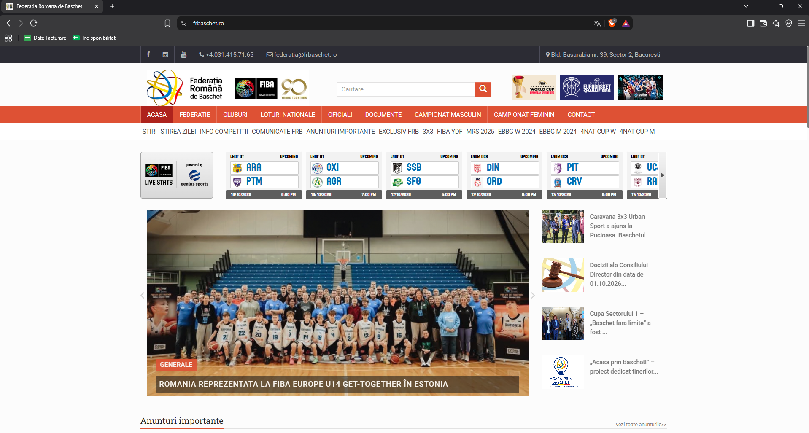
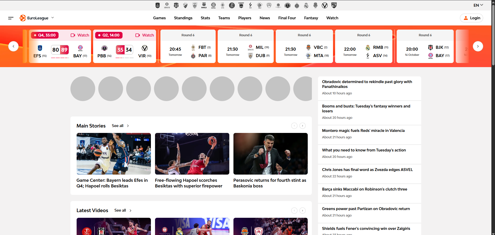
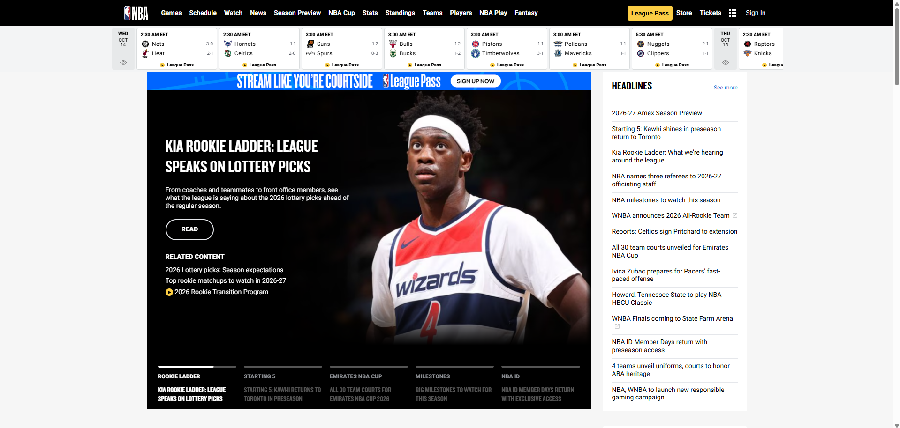
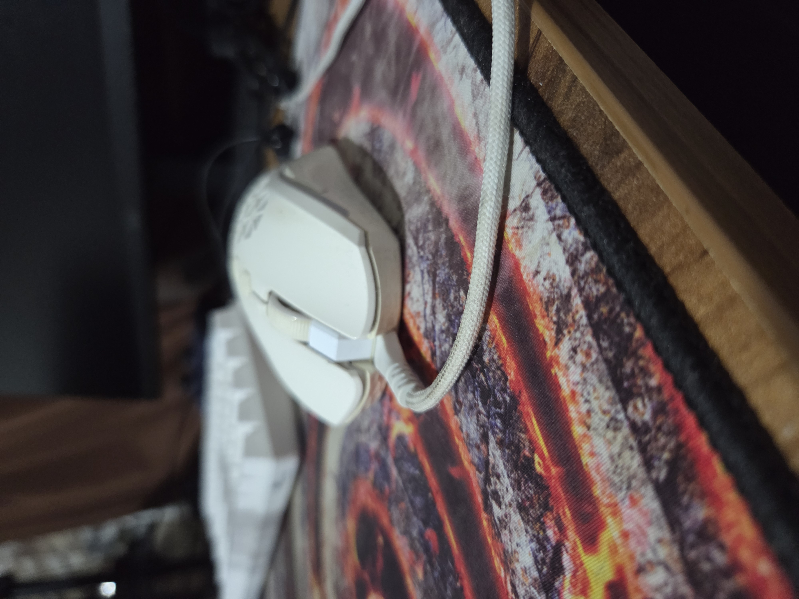
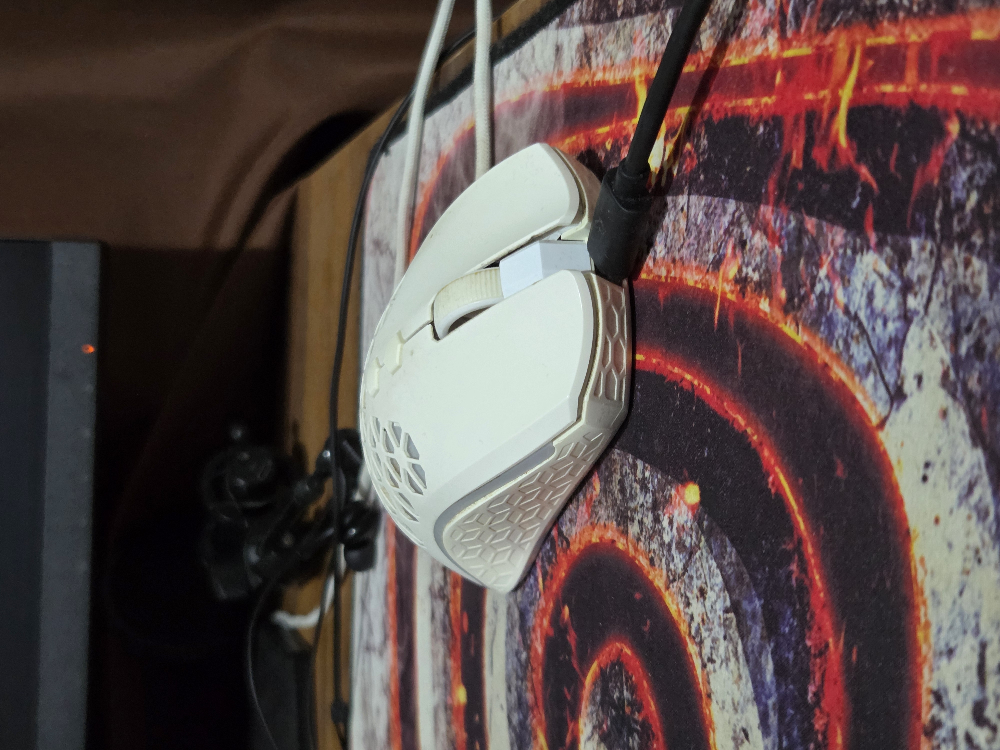

# Laborator 1 — Interacțiunea om–calculator

## Obiecte și interfețe prost proiectate

Identificați două exemple de obiecte prost proiectate din viața cotidiană (nu
fotografii de pe internet). Aduceți obiectele sau fotografii ale acestora și
oferiți exemple similare bine proiectate ori sugestii de îmbunătățire.

## Exemplul 1: Site-ul Federației Române de Baschet

### Interfața analizată

**Site:** [Federația Română de Baschet — FRB](https://www.frbaschet.ro/)

### Probleme identificate

- Designul site-ului este depășit și nu este responsive, ceea ce face navigarea
  dificilă.
- Apar frecvent bug-uri, iar unele date sunt neactualizate.
- Interfața este proiectată necorespunzător. De exemplu, bara din dreapta cu
  trei linii nu funcționează atunci când fereastra este redimensionată.

### Exemple similare, bine proiectate

#### Site-ul EuroLeague

[Accesează site-ul EuroLeague](https://www.euroleague.net/)

#### Site-ul NBA

[Accesează site-ul NBA](https://www.nba.com/)

### Sugestii de îmbunătățire

1. Realizarea unui redesign complet, responsive și modern.
2. Actualizarea regulată a conținutului și eliminarea bug-urilor.
3. Testarea interfeței pe dispozitive și rezoluții diferite, pentru a asigura o
   experiență bună utilizatorilor.

## Exemplul 2: Mouse gaming Aqirys

### Prototip analizat

**Mouse:** [Aqirys Polaris](https://www.emag.ro/mouse-gaming-aqirys-polaris-16000-dpi-rgb-alb-151984/pd/DBY61PMBM/?cmpid=149219)

### Probleme identificate
- Butoanele laterale sunt greu de apăsat, necesitând o forță mai mare decât
  ar fi normal.
- Butonul din mijloc (scroll) este foarte rigid și nu oferă o experiență plăcută la utilizare.
- Butonul de schimbare a DPI-ului este plasat într-o poziție incomodă, ceea ce face dificilă ajustarea rapidă a sensibilității în timpul jocului.
- Port-ul USB-C pentru încărcare este poziționat într-un mod care permite doar cablului din fabrică să fie utilizat, limitând astfel flexibilitatea utilizatorului.

### Exemple similare, bine proiectate

#### Mouse-ul Logitech Pro 2 LightSpeed

[Accesează site-ul Logitech Pro 2 LightSpeed](https://altex.ro/mouse-gaming-wireless-logitech-pro-2-lightspeed-32000-dpi-negru/cpd/MOU910007295/)

### Sugestii de îmbunătățire
1. Redesign-ul butoanelor laterale pentru a fi mai ușor de apăsat, cu o cursă mai scurtă și o rezistență mai mică.
2. Ajustarea butonului de scroll pentru a oferi o experiență mai fluidă și mai plăcută.
3. Repozitionarea butonului de schimbare a DPI-ului într-o zonă mai accesibilă, astfel încât utilizatorii să poată ajusta sensibilitatea rapid și eficient.
4. Modificarea portului USB-C pentru a permite utilizarea cablurilor standard, oferind astfel mai multă flexibilitate utilizatorilor în alegerea cablurilor de încărcare.